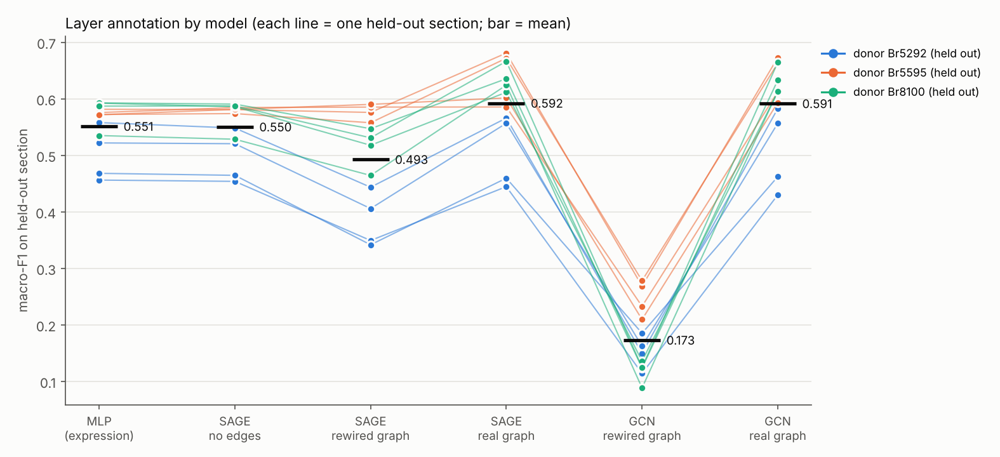
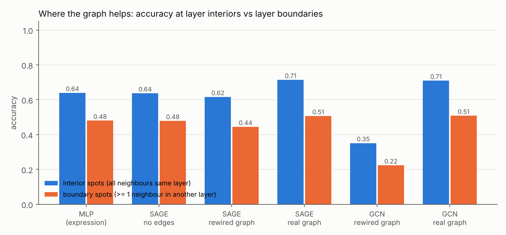
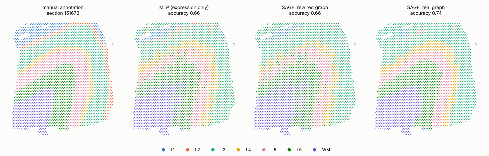

# Does the spatial graph help? Layer annotation in human DLPFC with a rewired-graph null

**Question.** In 10x Visium sections of human dorsolateral prefrontal cortex
(DLPFC), does giving a model each spot's spatial neighbourhood improve cortical
layer annotation over gene expression alone? And if it does, is the gain due to
**real spatial structure**, or would any extra edges with the same degrees do
just as well?

**Short answer (real LIBD DLPFC data, 12 sections, 3 donors).** Yes, modestly.
On sections from a donor the model never saw, GraphSAGE on the real k = 6
spatial graph reaches a mean per-section macro-F1 of **0.592** vs **0.551** for an
expression-only MLP (+0.041, better on 10 of 12 sections, Wilcoxon p = 0.007).
The same GraphSAGE on a **degree-preserving rewired graph** scores **0.493**,
below the MLP, so the rewired graph reproduces none of the gain: it comes from
which spots are connected, not from having neighbours at all. The gain is
uneven, though: about +0.06 on two held-out donors and +0.006 on the third, and
the graph makes the thin outer layers (L1, L2) worse. See [Results](#results).

---

## Why this control

Graph-based spatial methods such as STAGATE (Dong & Zhang, 2022) and GraphST
(Long et al., 2023) report better recovery of DLPFC layers than non-spatial
clustering. That comparison changes two things at once: the model sees
**neighbours**, and it sees **more input per spot**. A spatial graph could help
simply because averaging over any 6 spots denoises a sparse Visium profile, or
because random neighbours from the same section carry section-level information.

The test used here is a standard network-science null: keep every spot's degree
exactly, randomise who is connected to whom (double-edge swaps), and train the
identical model on the rewired graph. If the real graph's advantage survives
this, it depends on the real spatial arrangement.

I read the STAGATE and GraphST papers and did not find this control in either.
Both evaluate unsupervised clustering against the Maynard et al. labels with ARI
and compare against non-spatial methods. GraphST does shuffle data during
training: it shuffles expression vectors across spots on a fixed graph to make
negative examples for its contrastive loss. That is part of the training
objective, not an evaluation control. This is a check of two papers, not of the
whole literature, and this repository does supervised annotation rather than
clustering, so its numbers are not comparable to their ARI values.

## Data

| item | value |
|---|---|
| dataset | LIBD human DLPFC 10x Visium, 12 sections from 3 donors (Maynard et al., 2021) |
| counts | Space Ranger `filtered_feature_bc_matrix.h5`, from the Lieber Institute's public AWS bucket listed in the [HumanPilot README](https://github.com/LieberInstitute/HumanPilot) |
| coordinates | `tissue_positions_list.txt` per section, HumanPilot repository |
| labels | `10X/barcode_level_layer_map.tsv`, HumanPilot repository: manual annotation of layers L1 to L6 and white matter (WM) |
| labelled in-tissue spots used | 47,329 (3,431 to 4,788 per section) |
| genes | 33,538 measured; 2,000 highly variable genes used |
| donors | Br5292 (151507 to 151510), Br5595 (151669 to 151672), Br8100 (151673 to 151676) |

Donor Br5595's four sections contain no L1 or L2 spots. No login is needed;
`download_dlpfc.py` fetches about 140 MB.

## Methods

1. **Expression features.** Per-spot library-size normalisation and log1p, then
   2,000 highly variable genes, z-scoring and a 50-component PCA. The gene
   selection, scaling and PCA are **fitted on the training sections only** in
   each fold.
2. **Spatial graph.** For each section, an undirected k-nearest-neighbour graph
   on the spot pixel coordinates with k = 6, which on the Visium hexagonal grid
   is the ring of adjacent spots. Mean degree 6.12; spots at the tissue edge
   pick up a few longer edges. 92.7% of edges join two spots of the same layer.
3. **Rewired-graph null.** Each section's graph is randomised by double-edge
   swaps, (a, b), (c, d) → (a, d), (c, b), 10 accepted swaps per edge, rejecting
   swaps that create self-loops or duplicate edges. Every spot keeps its exact
   degree. A fresh rewiring is drawn for each seed. Same-layer edges fall to
   24.5%, equal to what random pairing gives (24.6%), so no spatial signal is
   left.
4. **Models.** All have two hidden layers of 128 units, ReLU, dropout 0.3 and a
   linear read-out.

   | variant | model | graph (training and testing) |
   |---|---|---|
   | `mlp` | MLP | none |
   | `sage_nograph` | GraphSAGE (mean aggregation) | none: same architecture, no neighbours |
   | `sage_real` | GraphSAGE | real k-NN graph |
   | `sage_rewired` | GraphSAGE | degree-preserving rewired graph |
   | `gcn_real` | GCN | real k-NN graph |
   | `gcn_rewired` | GCN | rewired graph |

   `sage_nograph` checks that any gain is not just the GraphSAGE architecture.
5. **Evaluation: leave one donor out.** Each fold trains on two donors and tests
   on all four sections of the third, so no tissue from the test donor is seen
   in training. Within the training donors, one section per donor is held out
   for early stopping (best validation macro-F1, patience 30, at most 300
   epochs). Training is full-batch with Adam (lr 5 × 10⁻³, weight decay
   5 × 10⁻⁴) and inverse-frequency class weights. Hyperparameters were fixed in
   advance and not tuned.
6. **Metric.** Macro-F1 per held-out section, averaged over the layers present in
   that section, so Br5595 sections are not penalised for having no L1/L2.
   Predicting an absent layer still counts as an error. Every variant is run
   with 5 seeds, and each section's score is the mean over seeds.
7. **Statistics.** Paired two-sided Wilcoxon signed-rank tests over the 12
   sections, 95% bootstrap intervals over sections, and the mean difference per
   held-out donor.

## Results

All numbers are from the real data (`results/metrics.json`, 5 seeds, leave one
donor out).

### Macro-F1 on held-out donors

| variant | mean per-section macro-F1 [95% CI] | accuracy | seed-to-seed SD |
|---|---|---|---|
| MLP (expression only) | 0.551 [0.524, 0.574] | 0.601 | 0.004 |
| GraphSAGE, no edges | 0.550 [0.523, 0.574] | 0.599 | 0.006 |
| GraphSAGE, rewired graph | 0.493 [0.442, 0.539] | 0.574 | 0.005 |
| **GraphSAGE, real graph** | **0.592 [0.548, 0.631]** | **0.665** | 0.006 |
| GCN, rewired graph | 0.173 [0.141, 0.207] | 0.320 | 0.006 |
| GCN, real graph | 0.591 [0.547, 0.630] | 0.662 | 0.011 |

### Paired comparisons (12 sections)

| comparison | Δ macro-F1 [95% CI] | sections better | Wilcoxon p | Δ per held-out donor (Br5292 / Br5595 / Br8100) |
|---|---|---|---|---|
| SAGE real − MLP | +0.041 [0.019, 0.063] | 10/12 | 0.007 | +0.006 / +0.060 / +0.058 |
| **SAGE real − SAGE rewired** | **+0.100 [0.071, 0.124]** | **12/12** | **0.0005** | +0.122 / +0.058 / +0.119 |
| SAGE rewired − MLP | −0.059 [−0.086, −0.031] | 2/12 | 0.007 | −0.116 / +0.002 / −0.062 |
| SAGE no edges − MLP | −0.001 [−0.004, 0.002] | 4/12 | 0.34 | −0.004 / +0.005 / −0.004 |
| SAGE real − SAGE no edges | +0.042 [0.020, 0.065] | 10/12 | 0.005 | +0.010 / +0.055 / +0.061 |
| GCN real − MLP | +0.040 [0.020, 0.060] | 10/12 | 0.007 | +0.007 / +0.060 / +0.054 |
| GCN real − GCN rewired | +0.418 [0.375, 0.463] | 12/12 | 0.0005 | +0.355 / +0.388 / +0.512 |

With 12 sections, 0.0005 is the smallest two-sided p the Wilcoxon test can give.

### Per-layer F1 (all 12 held-out sections pooled, seed 0)

| variant | L1 | L2 | L3 | L4 | L5 | L6 | WM |
|---|---|---|---|---|---|---|---|
| MLP | **0.44** | **0.22** | 0.67 | 0.43 | 0.69 | 0.62 | 0.71 |
| SAGE rewired | 0.13 | 0.05 | 0.66 | 0.40 | 0.69 | 0.61 | 0.68 |
| SAGE real | 0.24 | 0.18 | **0.73** | **0.55** | **0.79** | **0.75** | **0.75** |
| GCN real | 0.21 | 0.19 | 0.72 | 0.53 | 0.78 | 0.70 | 0.71 |

### Figures

| | |
|---|---|
|  |  |



*Section 151673 (donor Br8100 held out, seed 0): manual labels, then predictions
from the MLP, GraphSAGE on the rewired graph and GraphSAGE on the real graph.*

### Interpretation

- **The real graph helps, and the rewired null shows why.** GraphSAGE on the
  real graph beats the MLP by 0.041 macro-F1 and beats the same model on a
  degree-matched random graph by 0.100, on every one of the 12 sections. The
  no-edge GraphSAGE matches the MLP almost exactly, so the architecture alone
  adds nothing. The gain needs neighbours that are actually adjacent in the
  tissue.
- **Random edges do not just fail to help; they hurt.** The rewired graph pulls
  GraphSAGE 0.059 below the MLP, and GCN collapses (0.173). GCN has no separate
  weight for a spot's own features, so it cannot learn to ignore neighbours,
  and averaging with 6 random spots wipes out the spot's own signal. GraphSAGE
  has a separate self path, yet it still does worse than without edges. One
  possible explanation, not tested here: the mean of random neighbours roughly
  encodes the section's average profile, which the model can fit on training
  sections but which does not transfer to a new donor.
- **The gain sits in layer interiors and thick layers.** Accuracy rises from 0.64
  to 0.71 for spots whose neighbours all share their layer, but only from 0.48
  to 0.51 for spots at a layer boundary (22% of spots). L3 to WM improve by
  0.04 to 0.13 F1. L1 and L2, the thinnest layers and the ones at the tissue
  edge, get worse (L1 0.44 → 0.24): neighbour averaging smooths them into L3,
  which is visible at the top of the 151673 maps.
- **The benefit depends on the donor.** On held-out Br5292 the real graph adds
  only +0.006 over the MLP, against about +0.06 on the other two donors. On the
  held-out validation sections from the training donors (used for early
  stopping, so optimistic), the graph's advantage is larger: about 0.83 vs 0.70
  macro-F1. Shift between donors, not missing spatial context, is the main limit
  on transfer.

### Limitations

- Three donors. Leave one donor out gives only three folds, and sections from
  the same donor are not independent. The Wilcoxon tests treat the 12 sections
  as units, so the per-donor columns should be read alongside the p values. The
  Br5292 fold carries little of the gain.
- One graph construction (k = 6 on pixel coordinates) and one set of fixed
  hyperparameters. Other k, radius graphs, or edge weights by distance or
  histology were not tried.
- The rewired graph is the strictest structural null used here. A softer null
  that keeps distance but scrambles layer identity (for example, shuffling
  within a radius) was not run, so this does not separate "close in space" from
  "same layer".
- The labels are a manual annotation of layers, not cell types. Visium spots
  are about 55 µm across and contain several cells.
- Supervised annotation with labels from other donors is a different task from
  the unsupervised domain detection that STAGATE and GraphST were built for. No
  head-to-head comparison with those methods is made.

## Reproduce

```bash
pip install torch --index-url https://download.pytorch.org/whl/cpu   # or any PyTorch build
pip install -r requirements.txt
python download_dlpfc.py --dest data                 # about 140 MB
python run_experiment.py --data-dir data --out results --seeds 5
python make_figures.py --results results             # redraw figures from saved CSVs
```

The full run (3 folds × 5 seeds × 6 variants) took about 37 minutes on 4 CPU
cores. It writes `metrics.json`, `per_section_runs.csv` (every fold, seed,
variant and section), `graph_stats.csv`, `per_layer_f1_seed0.csv`,
`predictions_seed0.csv.gz` and the figures.

**Smoke test (synthetic data).** `python run_experiment.py --synthetic` builds 6
small layered sections on a hexagonal grid with a weak planted expression
signal, so the whole pipeline runs without the download. Its output is labelled
`SYNTHETIC` in the JSON and on every figure, and is not a result. CI runs it
along with the unit tests (`pytest`), which check that:

- the k-NN graph gives each interior hex-grid spot exactly 6 neighbours;
- rewiring keeps every degree, never creates self-loops or duplicate edges, and
  brings same-label edges down to the chance level;
- preprocessing learns nothing from test sections;
- graph models with no edges ignore all other spots;
- the 10x HDF5 reader and label join keep the right spots in the right order;
- the per-section macro-F1 ignores absent layers.

## Repository layout

```
stgnn/
  data.py         10x HDF5 reader, spot positions, layer labels, donors
  features.py     log-normalisation, HVG + z-score + PCA fitted on training sections
  graph.py        k-NN graph, degree-preserving rewiring, homophily, boundary spots
  models.py       MLP, GraphSAGE, GCN (PyTorch Geometric)
  train.py        full-batch training with early stopping on validation sections
  experiment.py   leave-one-donor-out loop and summary statistics
  metrics.py      per-section macro-F1, Wilcoxon, bootstrap, per-layer F1
  synthetic.py    synthetic layered tissue for the smoke test
  figures.py
run_experiment.py   main entry point
make_figures.py     redraw figures from saved results
download_dlpfc.py   fetch the public data
tests/              pytest unit tests and a synthetic end-to-end test
results/            outputs of the real-data run
```

## References

- Maynard, K. R., Collado-Torres, L., Weber, L. M., et al. (2021).
  Transcriptome-scale spatial gene expression in the human dorsolateral
  prefrontal cortex. *Nature Neuroscience* 24, 425–436.
  [doi:10.1038/s41593-020-00787-0](https://doi.org/10.1038/s41593-020-00787-0)
- Dong, K. & Zhang, S. (2022). Deciphering spatial domains from spatially
  resolved transcriptomics with an adaptive graph attention auto-encoder
  (STAGATE). *Nature Communications* 13, 1739.
  [doi:10.1038/s41467-022-29439-6](https://doi.org/10.1038/s41467-022-29439-6)
- Long, Y., Ang, K. S., Li, M., et al. (2023). Spatially informed clustering,
  integration, and deconvolution of spatial transcriptomics with GraphST.
  *Nature Communications* 14, 1155.
  [doi:10.1038/s41467-023-36796-3](https://doi.org/10.1038/s41467-023-36796-3)
- Hamilton, W. L., Ying, R. & Leskovec, J. (2017). Inductive representation
  learning on large graphs (GraphSAGE). *NeurIPS 2017*.
- Kipf, T. N. & Welling, M. (2017). Semi-supervised classification with graph
  convolutional networks. *ICLR 2017*.

If you use the data, cite Maynard et al. (2021) and follow the Lieber
Institute's terms for the HumanPilot data.

## License

Code: MIT (see `LICENSE`). The data belong to the Lieber Institute for Brain
Development and are distributed under their own terms.
